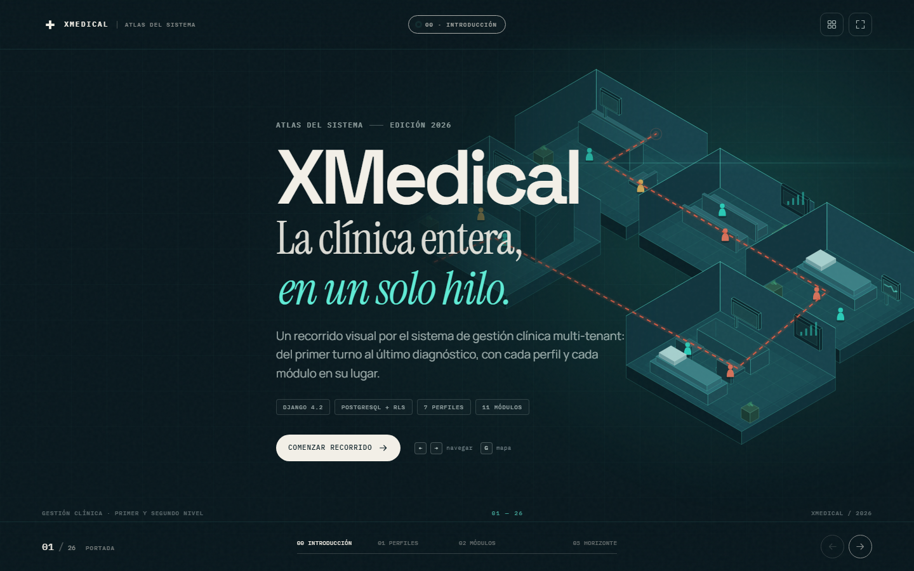

# XMedical · Atlas del sistema



Deck navegable de **26 slides** para explicar XMedical de punta a punta: primero el sistema completo, después cada perfil y cada módulo. Está construido solo con **HTML, CSS y JavaScript**, sin build step ni dependencias de runtime.

## Abrir

Doble clic en `index.html` (Chrome o Edge recomendados).

Si el navegador restringe fuentes o recursos locales, sirve la carpeta:

```powershell
python -m http.server 8080 --directory deck
```

Luego abre `http://localhost:8080`.

## Controles

| Acción | Atajo |
|---|---|
| Slide siguiente / anterior | `→` `←`, `Espacio`, `PageDown` / `PageUp` |
| Primera / última | `Home` / `End` |
| Mapa de slides | `G` |
| Pantalla completa | `F` |
| Cerrar mapa | `Esc` |
| Navegar en móvil | swipe horizontal |

También funcionan los botones inferiores, las tarjetas del mapa y los enlaces internos.

## Estructura del deck

| Capítulo | Slides | Contenido |
|---|---|---|
| 00 · Introducción | 01–05 | Portada, qué hace el sistema, plano de la clínica, mapa de módulos y arquitectura multi-tenant |
| 01 · Perfiles | 06–13 | Superadmin, administrador, recepción, enfermería, médico general, especialista y paciente |
| 02 · Módulos | 14–25 | Pacientes, citas, preclínica, consulta, referencias, QR, dashboards, IA predictiva, notificaciones, API y seguridad |
| 03 · Horizonte | 26 | Cierre y roadmap |

## Archivos

```text
deck/
├── index.html              # 26 slides + chrome + overview
├── assets/
│   ├── css/deck.css        # sistema visual, componentes y responsive
│   └── js/
│       ├── iso.js          # motor isométrico y escenas SVG
│       └── deck.js         # navegación, overview, contadores y QR
└── README.md
```

## Personalizar

- **Textos y orden:** edita `index.html`. Cada slide es un `<section class="slide" id="sNN">` con `data-title`, `data-summary`, `data-chapter` y `data-tone`.
- **Color y tipografía:** variables CSS al inicio de `deck.css` (`--paper`, `--ink`, `--teal`, `--coral`, fuentes).
- **Escenas isométricas:** `iso.js` contiene las escenas `hero`, `clinic`, `campus`, `stack` y las siete escenas de perfil. Se dibujan con primitivas (`box`, `slab`, `room`, `desk`, `bed`, `person`).
- **Navegación:** `deck.js` maneja el hash (`#s07`), teclado, overview, capítulos y el plan 2D/3D.

## Modo captura / QA

- `?static=1`: desactiva transiciones para capturas.
- `?plan=flat`: abre la slide 03 en vista de planta.
- `?overview=1`: abre el mapa de slides.
- `?slide=15`: abre directamente un slide por número.

## Notas

- Los datos clínicos de los ejemplos (pacientes, presiones, citas) son **sintéticos**.
- El deck es un documento visual: **no consulta el backend ni modifica datos**.
- La tipografía usa Google Fonts; si no hay red, cae a fuentes del sistema.
- Respeta `prefers-reduced-motion` y tiene navegación por teclado.
- Verificado a 1440×900, 1280×720, 1024×768 y 500×900; en anchos menores el contenido pasa a una columna y la slide hace scroll.
