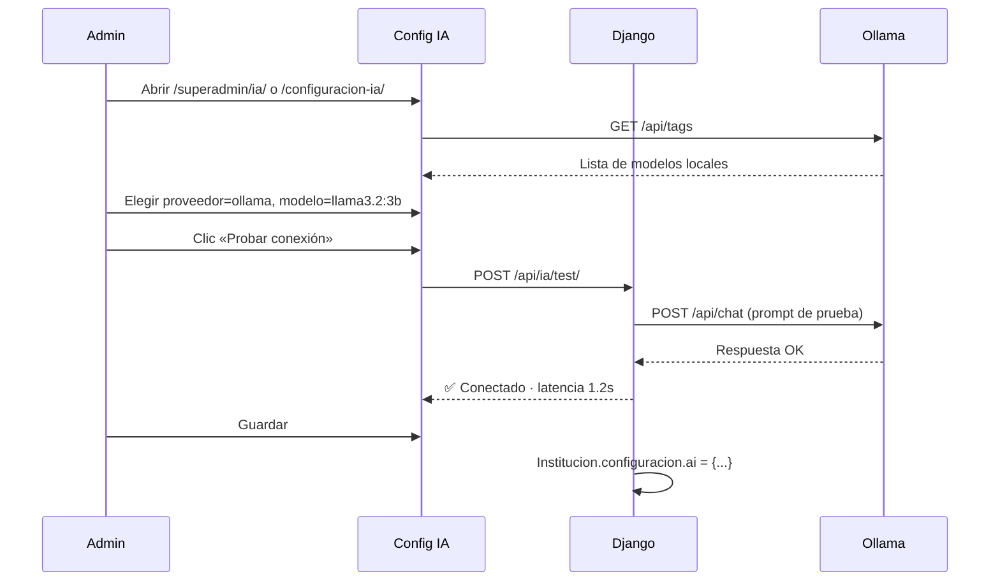

# DOCUMENTO 16: MODELO LOCAL IA (OLLAMA)
## XMedical — LLM on-premise vía interfaz web

| Versión | Fecha | Autor | Estado |
|---------|-------|-------|--------|
| 1.1 | 2026-07 | Equipo XMedical | **Fase 1 implementada** (`OllamaProvider`) |

---

## 1. OBJETIVO

Permitir que XMedical use un **modelo de lenguaje ejecutado localmente** (sin enviar datos clínicos a la nube), configurable desde la **interfaz web**, siguiendo el mismo patrón adoptado en **Salud360**:

- Motor local: **Ollama** (`http://localhost:11434`)
- Selección de modelo desde la UI (lista dinámica de modelos instalados)
- Mismos casos de uso que OpenAI/OpenRouter: sugerencia diagnóstica, resumen clínico, ayuda de redacción, OCR asistido
- Configuración **global** (`.env`) y **por institución** (`Institucion.configuracion["ai"]`)
- Fallback automático a proveedor cloud si Ollama no responde (opcional, desactivable)

> **Referencia Salud360:** panel de administración → proveedor IA → Ollama → elegir modelo → probar conexión → activar en wizard de consulta y OCR.

---

## 2. ESTADO ACTUAL vs. OBJETIVO

| Componente | Hoy (XMedical) | Objetivo |
|------------|----------------|----------|
| `apps/core/ai_services.py` | OpenAI + OpenRouter | + `OllamaProvider` |
| `AI_PROVIDER` | `openai` \| `openrouter` | + `ollama` |
| Config por institución | JSON `configuracion.ai` (parcial) | UI completa en superadmin/admin |
| Interfaz de selección | Solo variables `.env` | Pantalla **Configuración IA** |
| Prueba de conexión | No existe | Botón «Probar modelo» en UI |
| Listado de modelos | Manual en `.env` | GET `/api/tags` de Ollama |
| Wizard consulta (paso 5) | Cloud si hay API key | Local u cloud según config |
| OCR pacientes | Cloud vision (planificado) | LLaVA local vía Ollama (opcional) |
| Privacidad / HIPAA | Depende del proveedor cloud | Datos clínicos no salen del servidor |

---

## 3. ARQUITECTURA

```
┌─────────────────────────────────────────────────────────────┐
│  Interfaz web (Django)                                       │
│  ┌──────────────────┐  ┌─────────────────────────────────┐  │
│  │ Preferencias IA  │  │ Wizard consulta / OCR pacientes │  │
│  │ (admin/superadmin)│  │  botón «Sugerir con IA»         │  │
│  └────────┬─────────┘  └──────────────┬──────────────────┘  │
│           │                           │                      │
│           ▼                           ▼                      │
│  ┌─────────────────────────────────────────────────────┐   │
│  │  AIClient (apps/core/ai_services.py)                  │   │
│  │  get_ai_config() → build_provider()                   │   │
│  └──────────────┬──────────────────┬───────────────────┘   │
│                 │                  │                         │
│     ┌───────────▼──────────┐  ┌────▼────────────┐           │
│     │ OpenAIProvider       │  │ OllamaProvider  │           │
│     │ OpenRouterProvider   │  │ (nuevo)         │           │
│     └───────────┬──────────┘  └────┬────────────┘           │
└─────────────────┼──────────────────┼─────────────────────────┘
                  │                  │
                  ▼                  ▼
         api.openai.com      localhost:11434
         openrouter.ai        (Ollama daemon)
                              ├─ llama3.2:3b
                              ├─ mistral:7b
                              └─ llava:7b (visión)
```

### 3.1 Flujo de configuración (UI)



---

## 4. CAMBIOS TÉCNICOS PLANIFICADOS

### 4.1 Backend — `OllamaProvider`

Archivo: `apps/core/ai_services.py`

```python
class OllamaProvider(BaseAIProvider):
    provider_name = "ollama"

    def is_configured(self) -> bool:
        return bool(self.default_model and self.base_url)

    def complete(self, system_prompt, user_prompt, model=None, temperature=0.2):
        # POST {base_url}/api/chat
        # body: { model, messages, stream: false, options: { temperature } }
        ...

    def list_models(self) -> list[str]:
        # GET {base_url}/api/tags → models[].name
        ...

    def health_check(self) -> dict:
        # GET {base_url}/api/tags + mini chat de prueba
        ...
```

Actualizar `build_provider()`:

```python
def build_provider(config: AIConfig) -> BaseAIProvider:
    if config.provider == "ollama":
        return OllamaProvider(default_model=config.model)
    if config.provider == "openrouter":
        return OpenRouterProvider(default_model=config.model)
    return OpenAIProvider(default_model=config.model)
```

### 4.2 Variables de entorno

```env
# Proveedor: openai | openrouter | ollama
AI_PROVIDER=ollama

# Ollama (modelo local)
OLLAMA_BASE_URL=http://localhost:11434
OLLAMA_MODEL=llama3.2:3b
OLLAMA_TIMEOUT=120
OLLAMA_VISION_MODEL=llava:7b
```

### 4.3 Configuración por institución

Estructura en `Institucion.configuracion`:

```json
{
  "ai": {
    "provider": "ollama",
    "model": "llama3.2:3b",
    "vision_model": "llava:7b",
    "temperature": 0.2,
    "enabled": true,
    "fallback_cloud": false,
    "features": {
      "diagnostico_sugerido": true,
      "resumen_clinico": true,
      "ocr_asistido": true
    }
  }
}
```

### 4.4 Nueva app / vistas — Interfaz web

| Ruta | Rol | Descripción |
|------|-----|-------------|
| `GET /configuracion-ia/` | Admin institución | Panel de IA de la clínica |
| `GET /superadmin/ia/` | Superadmin | Config global + por tenant |
| `POST /configuracion-ia/probar/` | Admin | Prueba de conexión (AJAX) |
| `GET /configuracion-ia/modelos/` | Admin | JSON: modelos Ollama disponibles |

**Pantalla «Configuración IA» (similar Salud360):**

```
┌─────────────────────────────────────────────────────────┐
│  Configuración de Inteligencia Artificial               │
├─────────────────────────────────────────────────────────┤
│  Proveedor:  ( ) OpenAI  ( ) OpenRouter  (•) Ollama local│
│                                                          │
│  URL Ollama:  [ http://localhost:11434        ] [Probar] │
│  Modelo texto: [ llama3.2:3b          ▼ ]  ✅ 1.2s     │
│  Modelo visión: [ llava:7b            ▼ ]  ⚠ no instalado│
│  Temperatura:  [====●=====] 0.2                          │
│                                                          │
│  Funciones activas:                                      │
│  [✓] Sugerencia diagnóstica (wizard paso 5)             │
│  [✓] Resumen clínico                                     │
│  [✓] OCR asistido (documentos paciente)                 │
│  [ ] Fallback a cloud si Ollama falla                   │
│                                                          │
│  [ Guardar ]  [ Restaurar defaults ]                    │
└─────────────────────────────────────────────────────────┘
```

### 4.5 Integración en flujos existentes

| Flujo | Cambio |
|-------|--------|
| Wizard consulta paso 5 | `AIClient(institucion).complete(...)` ya existe; solo añadir provider ollama |
| OCR pacientes | `vision_service.py` → intentar `OLLAMA_VISION_MODEL` antes de cloud |
| Dashboard admin | Badge «IA: Local (llama3.2)» o «IA: Cloud (gpt-4o-mini)» |
| API REST `/api/v1/` | Mismo `AIClient`; sin cambios de contrato |

---

## 5. MODELOS RECOMENDADOS (OLLAMA)

| Modelo | RAM mínima | Uso en XMedical | Comando |
|--------|------------|-----------------|---------|
| `llama3.2:3b` | 4 GB | Sugerencia diagnóstica, resúmenes | `ollama pull llama3.2:3b` |
| `mistral:7b` | 8 GB | Mejor calidad clínica en español | `ollama pull mistral:7b` |
| `gemma2:2b` | 4 GB | Tareas ligeras, baja latencia | `ollama pull gemma2:2b` |
| `llava:7b` | 8 GB | OCR / análisis de imágenes médicas | `ollama pull llava:7b` |
| `medllama2` | 8 GB | Especializado salud (si disponible) | `ollama pull medllama2` |

**Recomendación inicial para clínicas pequeñas:** `llama3.2:3b` (texto) + `llava:7b` (visión opcional).

---

## 6. INSTALACIÓN OLLAMA (SERVIDOR)

### 6.1 Linux (producción / VM clínica)

```bash
curl -fsSL https://ollama.com/install.sh | sh
sudo systemctl enable ollama
sudo systemctl start ollama
ollama pull llama3.2:3b
```

### 6.2 Docker (junto a XMedical)

Añadir a `docker-compose.yml` (planificado):

```yaml
  ollama:
    image: ollama/ollama:latest
    ports:
      - "11434:11434"
    volumes:
      - ollama_data:/root/.ollama
    deploy:
      resources:
        reservations:
          devices:
            - capabilities: [gpu]  # opcional NVIDIA
```

XMedical en `.env`:

```env
AI_PROVIDER=ollama
OLLAMA_BASE_URL=http://ollama:11434
OLLAMA_MODEL=llama3.2:3b
```

### 6.3 Windows (desarrollo)

```powershell
winget install Ollama.Ollama
ollama pull llama3.2:3b
ollama serve
```

---

## 7. SEGURIDAD Y CUMPLIMIENTO

| Tema | Medida |
|------|--------|
| Datos clínicos | Con Ollama local, prompts no salen del servidor |
| Auditoría | Registrar en `AuditoriaLog`: uso IA, provider, modelo (sin prompt completo) |
| Consentimiento | Flag `ia_habilitada` por institución; desactivable |
| RBAC | Solo admin/superadmin configura IA; médico solo usa «Sugerir» |
| Rate limit | Máx. N solicitudes/min por usuario (Celery async para respuestas largas) |
| Disclaimer UI | «Sugerencia de apoyo; no reemplaza criterio médico» (obligatorio) |
| Red | Ollama **no** debe exponerse a Internet; solo red interna/Docker |

Ver también: [Documento 7 — Seguridad](7%20Documento%20de%20Seguridad.md), [Roadmap SEC-P30](14%20Roadmap%20Seguridad.md) (planificado).

---

## 8. PLAN DE IMPLEMENTACIÓN

| Fase | Entregable | Dependencias |
|------|------------|--------------|
| **1** | `OllamaProvider` + tests con mock | Ninguna | ✅ Implementado |
| **2** | Variables `.env` + `get_ai_config()` para ollama | Fase 1 |
| **3** | Vista `/configuracion-ia/` + listado modelos + probar conexión | Fase 2 |
| **4** | Integración wizard consulta (paso 5 diagnóstico) | Fase 3 |
| **5** | OCR local con `llava` en pacientes | Fase 3 |
| **6** | Docker Compose servicio `ollama` + doc despliegue | Fase 2 |
| **7** | API REST endpoint `POST /api/v1/ia/sugerir/` (opcional) | Fase 4 |

### Historias de usuario (backlog)

| ID | Historia | Criterio de aceptación |
|----|----------|------------------------|
| HU-IA-01 | Como admin quiero elegir Ollama como proveedor desde la web | Selector en `/configuracion-ia/` persiste en `configuracion.ai` |
| HU-IA-02 | Como admin quiero ver modelos instalados en Ollama | Dropdown poblado desde `/api/tags` |
| HU-IA-03 | Como admin quiero probar la conexión antes de guardar | Botón muestra latencia y estado OK/error |
| HU-IA-04 | Como médico quiero sugerencia diagnóstica con modelo local | Wizard paso 5 funciona sin API key cloud |
| HU-IA-05 | Como DPO quiero que los datos no salgan del servidor | Con `provider=ollama`, logs confirman URL local |

---

## 9. PRUEBAS

| ID | Tipo | Descripción |
|----|------|-------------|
| IA-L01 | Unit | `OllamaProvider.complete()` con mock HTTP |
| IA-L02 | Unit | `list_models()` parsea respuesta `/api/tags` |
| IA-L03 | Unit | `health_check()` timeout y error de conexión |
| IA-L04 | Integration | Admin guarda config → wizard usa ollama |
| IA-L05 | Manual | `ollama serve` + probar desde UI «Probar conexión» |
| IA-L06 | Security | Ollama no accesible desde IP pública |

---

## 10. COMPARATIVA: CLOUD vs. LOCAL

| Criterio | OpenAI / OpenRouter | Ollama (local) |
|----------|---------------------|----------------|
| Privacidad | Datos en proveedor externo | 100 % on-premise |
| Costo | Por token | Hardware + electricidad |
| Calidad | Alta (GPT-4, etc.) | Media-alta según modelo |
| Latencia | Red + cola | Baja en LAN |
| Offline | No | Sí (sin Internet) |
| Configuración | API key | Instalar Ollama + pull model |
| Ideal para | Demos, baja carga GPU | Clínicas con política de datos estricta |

**Estrategia híbrida (recomendada):** Ollama por defecto en producción clínica; OpenRouter como fallback opcional desactivado por defecto.

---

## 11. REFERENCIAS

- [Documento 9 — Integraciones](9%20Documento%20de%20integraciones.md) §3.3 IA-LLM
- [Documento 4 — Arquitectura](4%20Documento%20Arquitectura%20de%20alto%20nivel.md)
- [PROMPTS_FASE2_DIVIDIDA.md](../PROMPTS_FASE2_DIVIDIDA.md) — Prompt 1 (infra IA)
- [Ollama API](https://github.com/ollama/ollama/blob/main/docs/api.md)
- Código actual: `apps/core/ai_services.py`, `tests/test_ai_services.py`

---

**Fin del Documento 16: Modelo Local IA (Ollama)**
