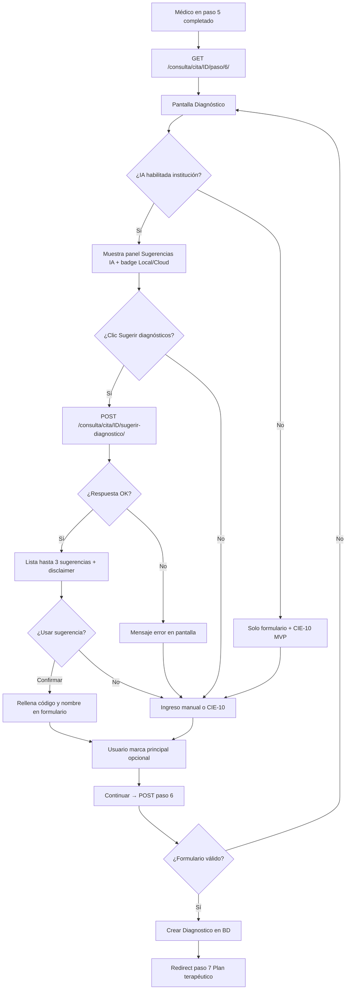
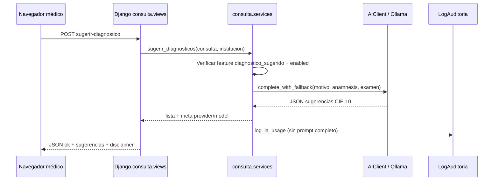
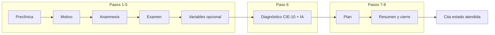

# DOCUMENTO 17: CARACTERÍSTICAS, PANTALLAS Y FLUJO 6 (DIAGNÓSTICO)
## XMedical — Referencia funcional alineada al código (2026)

| Versión | Fecha | Autor | Estado |
|---------|-------|-------|--------|
| 1.0 | 2026-10 | Equipo XMedical | **Referencia viva** |

---

## 1. PROPÓSITO

Este documento resume **qué hace XMedical hoy**, **qué pantallas existen** (rutas web) y describe en detalle el **Flujo 6 del wizard de consulta**: el paso **Diagnóstico** (CIE-10 + sugerencias IA).

> **Nota de numeración:** En código (`apps/consulta/wizard.py`) el wizard tiene **8 pasos**. El **paso 6** es *Diagnóstico*. El documento 5 (Diagramas de Flujo) usa una numeración antigua de 7 pasos; aquí se alinea con la implementación actual.

---

## 2. CARACTERÍSTICAS PRINCIPALES DEL PROGRAMA

### 2.1 Plataforma

| Característica | Descripción |
|----------------|-------------|
| **Multi-tenant** | Cada **institución** (clínica) tiene datos aislados; acceso por subdominio o selector en login |
| **Roles RBAC** | Admin, médico, enfermera, recepcionista, superadmin, paciente (portal) |
| **Stack** | Django 4.2, PostgreSQL, Redis/Celery, plantillas HTML + Tailwind/DaisyUI |
| **Auditoría** | Registro de cambios en entidades clínicas y uso de IA (`LogAuditoria`) |
| **Preferencias UI** | Temas visuales por usuario |

### 2.2 Módulos funcionales (implementados)

| Módulo | Qué permite |
|--------|-------------|
| **Autenticación** | Login/logout, registro de profesional, preferencias visuales |
| **Pacientes** | Lista, alta, edición, detalle, historia; **OCR** de documento de identidad (local/cloud) |
| **Citas** | Lista, agendar (estándar y flexible), cancelar |
| **Preclínica** | Lista de citas pendientes, registro de signos vitales |
| **Consulta (wizard)** | Atención médica guiada en 8 pasos, autosave, IA en diagnóstico |
| **Referencias** | Crear, aceptar/rechazar, agendar, contrarreferencia (1.er ↔ 2.do nivel) |
| **QR** | Generar/validar códigos ligados a consultas |
| **Dashboards** | Enfermería, administración, epidemiología, especialista |
| **Portal paciente** | Citas, solicitar cita, historia, exportación |
| **Core / admin institución** | Dashboard médico, auditoría, **configuración IA**, superadmin (tenants, backup, export/import) |
| **IA clínica** | Ollama/OpenAI/OpenRouter; config por institución; sugerencia diagnóstica y OCR asistido |

Referencias técnicas: [Doc 0](0%20Documento%20de%20Descripcion%20General.md), [Doc 16](16%20Modelo%20Local%20IA%20(Ollama).md), [Doc 4](4%20Documento%20Arquitectura%20de%20alto%20nivel.md).

---

## 3. CATÁLOGO DE PANTALLAS (RUTAS WEB)

Leyenda de roles: **T** todos autenticados del staff; **M** médico/admin consulta; **R** recepción; **E** enfermería; **A** admin; **S** superadmin; **P** paciente.

### 3.1 Acceso y home

| Ruta | Nombre | Rol | Descripción |
|------|--------|-----|-------------|
| `/` | Inicio | T / público | Redirige a dashboard o login |
| `/auth/login/` | Login | Público | Credenciales + selector de clínica si no hay subdominio |
| `/auth/logout/` | Logout | T | Cierre de sesión |
| `/auth/registro/` | Registro profesional | T | Alta de usuario profesional (según permisos) |
| `/auth/preferencias/` | Preferencias visuales | T / P | Tema de colores |

### 3.2 Clínica — operación diaria

| Ruta | Nombre | Rol | Descripción |
|------|--------|-----|-------------|
| `/dashboard/` | Inicio clínico | T | Redirige por rol (médico, recepción, dashboards, portal) |
| `/pacientes/` | Lista pacientes | M, R, … | Búsqueda y listado |
| `/pacientes/nuevo/` | Nuevo paciente | R, A | Formulario de registro |
| `/pacientes/ocr/` | Escanear documento | R, A | Subida imagen → OCR |
| `/pacientes/ocr/revisar/` | Revisar OCR | R, A | Confirmar datos extraídos |
| `/pacientes/<id>/` | Detalle paciente | Según RBAC | Ficha del paciente |
| `/pacientes/<id>/editar/` | Editar paciente | R, A | |
| `/pacientes/<id>/historia/` | Historia | M, A | Redirige a historia clínica |
| `/citas/` | Lista citas | M, R, A | |
| `/citas/agendar/` | Agendar cita | R, A | |
| `/citas/agendar-flexible/` | Agendar flexible | R, A | Rango de fechas |
| `/citas/<id>/cancelar/` | Cancelar cita | M, R, A | |
| `/preclinica/` | Lista preclínica | E, A | Citas para signos vitales |
| `/preclinica/<cita_id>/` | Registro preclínica | E, A | TA, FC, etc. |
| `/consulta/cita/<id>/paso/<step>/` | **Wizard consulta** | M, A | Pasos 1–8 (ver §4) |
| `/consulta/historia/<paciente_id>/` | Historia clínica | M, A | Consultas previas |
| `/referencias/` | Bandeja referencias | M, A | |
| `/referencias/nueva/<consulta_id>/` | Nueva referencia | M, A | |

### 3.3 Reportes y sistema

| Ruta | Nombre | Rol | Descripción |
|------|--------|-----|-------------|
| `/dashboards/enfermeria/` | Dashboard enfermería | E, A | |
| `/dashboards/administracion/` | Dashboard administración | A | |
| `/dashboards/epidemiologia/` | Epidemiología | A | |
| `/dashboards/especialista/` | Especialista 2.º nivel | M (2.º nivel) | |
| `/auditoria/` | Auditoría | A | Log de cambios |
| `/configuracion-ia/` | **Configuración IA** | A, S | Proveedor, modelos Ollama, features |
| `/superadmin/` | Superadmin | S | Instituciones, métricas, backup |
| `/portal/` | Portal paciente | P | Citas, historia, solicitar cita |

### 3.4 Navegación lateral (sidebar)

Secciones típicas para staff:

- **Clínica:** Inicio, Pacientes, Citas, Preclínica, Referencias  
- **Reportes:** Enfermería, Administración, Epidemiología, Especialista  
- **Sistema:** Superadmin (S), Auditoría (A), **Configuración IA** (A), Preferencias  

---

## 4. WIZARD DE CONSULTA — LOS 8 PASOS

| Paso | Nombre (UI) | Plantilla / contenido | Autosave |
|------|-------------|------------------------|----------|
| **1** | Revisar preclínica | Signos vitales de la cita | No |
| **2** | Motivo de consulta | Texto libre | Sí (cada 30 s) |
| **3** | Anamnesis | Texto libre | Sí |
| **4** | Examen físico | Texto libre | Sí |
| **5** | Variables clínicas | Campos parametrizados por especialidad | No* |
| **6** | **Diagnóstico** | CIE-10 + IA + búsqueda | No |
| **7** | Plan terapéutico | Plan y conducta | Sí |
| **8** | Resumen | Revisión y **Finalizar consulta** | No |

\* El paso 5 se **omite automáticamente** si la cita no tiene variables configuradas (`siguiente_paso` / `paso_anterior` en `wizard.py`).

**URL del paso 6:**  
`/consulta/cita/<cita_id>/paso/6/`

**Atajo:** Ctrl+Enter envía el formulario «Continuar».

---

## 5. FLUJO 6 — DIAGNÓSTICO (DETALLE)

### 5.1 Objetivo del paso

El médico registra uno o más **diagnósticos CIE-10** asociados a la consulta en curso. Puede:

- Escribir código y nombre manualmente  
- Elegir del listado MVP o buscar vía `/consulta/cie10/?q=...`  
- Pedir **sugerencias IA** (si la institución lo tiene habilitado)  

Cada vez que pulsa **Continuar →** con el formulario válido, el sistema **crea un registro** `Diagnostico` (no sustituye el anterior; permite varios diagnósticos en la misma visita al volver al paso o en flujos repetidos).

### 5.2 Diagrama de flujo (usuario)

### 5.3 Diagrama de flujo (sistema — sugerencia IA)

**Datos enviados al modelo:** solo `motivo_consulta`, `anamnesis` y `examen_fisico` de la consulta (no nombre del paciente en el prompt de servicio). El médico debe **confirmar** antes de aplicar una sugerencia al formulario (`wizard.js` → `confirm()`).

### 5.4 Pantalla — elementos UI (paso 6)

| Zona | Elemento | Comportamiento |
|------|----------|----------------|
| Cabecera | Paso 6 de 8 · Diagnóstico | Barra de progreso del wizard |
| Columna izquierda | `DiagnosticoForm` | `codigo_cie10`, `nombre`, `es_principal` |
| Columna derecha (si IA) | Badge p. ej. `Local (llama3.2:3b)` | Config institución |
| Columna derecha (si IA) | Botón **Sugerir diagnósticos** | AJAX POST |
| Columna derecha (si IA) | `#ia-sugerencias` | Tarjetas con «Usar esta sugerencia» |
| Columna derecha | Buscador CIE-10 | Autocompletado vía API interna |
| Pie | Anterior / Continuar | POST guarda diagnóstico y avanza a paso 7 |

### 5.5 Endpoints relacionados con el paso 6

| Método | Ruta | Función |
|--------|------|---------|
| GET/POST | `/consulta/cita/<id>/paso/6/` | Render y guardado del paso |
| POST | `/consulta/cita/<id>/sugerir-diagnostico/` | JSON sugerencias IA |
| GET | `/consulta/cie10/?q=<texto>` | JSON búsqueda CIE-10 MVP |

### 5.6 Condiciones para ver el botón IA

Deben cumplirse **todas** (función `ia_diagnostico_disponible`):

1. Institución con `configuracion.ai.enabled = true`  
2. Feature `diagnostico_sugerido = true`  
3. Proveedor configurado (p. ej. Ollama con URL + modelo, u OpenAI con API key en `.env`)  

Configuración: **`/configuracion-ia/`** (rol admin). Ver [Doc 16 §5.1](16%20Modelo%20Local%20IA%20(Ollama).md).

### 5.7 Permisos

- Acceso al wizard: rol **médico** o **admin** (`CAN_CONSULTA`, `MedicoRequiredMixin`)  
- Sugerir diagnóstico: mismo rol, POST autenticado con CSRF  

### 5.8 Errores habituales

| Síntoma | Causa probable |
|---------|----------------|
| No aparece botón IA | IA desactivada, feature off, o sin Ollama/API configurada |
| Error 400 al sugerir | IA no disponible / institución deshabilitada |
| Error 502 | Ollama caído o timeout; probar con «Probar conexión» en Config IA |
| Sin sugerencias vacías | Motivo, anamnesis y examen físico todos vacíos |

---

## 6. FLUJO CLÍNICO RESUMIDO (CONTEXTO DEL PASO 6)

---

## 7. RELACIÓN CON OTROS DOCUMENTOS

| Tema | Documento |
|------|-----------|
| Flujos generales (numeración legacy) | [Doc 5 §2.4](5%20Documento%20Diagramas%20de%20Flujo.md) |
| Historias de usuario consulta | [Doc 3](3%20Documento%20de%20Historias%20de%20Usuario.md) |
| Modelo `Consulta` / `Diagnostico` | [Doc 6](6%20Documento%20Modelo%20de%20datos.md) |
| IA Ollama, VPS, modelos | [Doc 16](16%20Modelo%20Local%20IA%20(Ollama).md) |
| Pruebas manuales | [CHECKLIST-UAT.md](CHECKLIST-UAT.md) |

---

## 8. ARCHIVOS DE CÓDIGO DE REFERENCIA (FLUJO 6)

| Archivo | Rol |
|---------|-----|
| `apps/consulta/wizard.py` | Definición de pasos 1–8 |
| `apps/consulta/views.py` | `ConsultaWizardView`, `sugerir_diagnostico` |
| `apps/consulta/services.py` | `sugerir_diagnosticos`, parseo JSON IA |
| `apps/consulta/templates/consulta/paso5_diagnostico.html` | UI paso 6 (nombre histórico del template) |
| `apps/consulta/templates/consulta/wizard.html` | Shell del wizard |
| `static/js/wizard.js` | AJAX sugerencias IA |
| `apps/core/ai_institution_config.py` | Flags IA por institución |
| `apps/core/views_ai.py` | Pantalla configuración IA |

---

**Fin del Documento 17**
