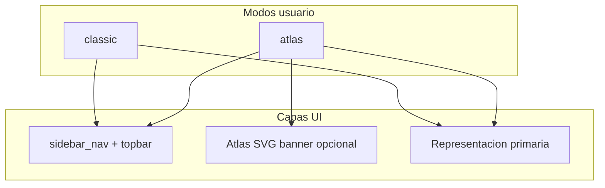

# Arquitectura visual de pantallas (visual-design-architect)

Marco de decisión para la UI web de XMedical: qué representación visual corresponde a cada ruta, cómo se relaciona con el **modo Atlas** (`classic` | `atlas`) y qué **no** debe isometrizarse.

Referencias:

- Matriz de la skill: [`.cursor/skills/visual-design-architect/references/decision-matrix.md`](../.cursor/skills/visual-design-architect/references/decision-matrix.md)
- Modo Atlas: [doc 18](18%20Interfaz%20Atlas%20Despliegue%20Produccion.md), [`apps/core/atlas_ui.py`](../apps/core/atlas_ui.py)
- Contratos piloto: [`docs/visual-briefs/`](visual-briefs/)
- Agentes: [`AGENTS.md`](../AGENTS.md), [`.cursor/README.md`](../.cursor/README.md)

## Principios

1. **Modo classic y Atlas son equivalentes en funcionalidad.** Atlas añade estilos (`static/css/atlas.css`) y, opcionalmente, **contexto espacial** (`static/js/iso.js` vía `data-iso`), no reemplaza tablas ni formularios.
2. **Una representación primaria por pantalla** (tabla, formulario, wizard, hilo, stats). La isometría es **complemento** salvo recepción (hero + hilo).
3. **Nueva pantalla:** añadir fila a la matriz de este documento antes del PR de UI; usar skill `visual-design-architect` si hay duda.

## Leyenda de columnas

| Columna | Significado |
|---------|-------------|
| **Primaria** | Cómo el usuario completa la tarea (obligatorio en ambos modos). |
| **Atlas complemento** | `none`, `banner` (`atlas_scene_banner`), `hero` (`atlas_hero` + acciones) o `hub` (módulos isométricos interactivos + panel de exploración). |
| **Escena ISO** | Valor en `_ROUTE_SCENES` o fallback por rol en `resolve_atlas_iso_scene`. |
| **No isometrizar** | Contenido que no debe pasarse a SVG 2.5D interactivo. |

---

## Matriz completa (`url_name`)

Excluye API REST (`api_*`), Django admin y plantillas de email.

### Autenticación y preferencias

| url_name | Tarea primaria | Primaria | Atlas complemento | Escena ISO | No isometrizar |
|----------|----------------|----------|-------------------|------------|----------------|
| `login` | Iniciar sesión staff | Formulario | none | — | Campos credenciales |
| `login_paciente` | Iniciar sesión portal | Formulario | none | — | Idem |
| `logout` | Cerrar sesión | Redirect | none | — | — |
| `registro_profesional` | Alta profesional | Formulario | none | — | Validaciones |
| `preferencias_visuales` | Tema y modo UI | Formulario + radios | banner | `clinic` | Selector modo |

### Inicio y dashboards clínicos

| url_name | Tarea primaria | Primaria | Atlas complemento | Escena ISO | No isometrizar |
|----------|----------------|----------|-------------------|------------|----------------|
| `home` | Redirigir según rol | Redirect | none | fallback rol | — |
| `dashboard` | Resumen médico | Tabla de agenda + stats | **hub** (3 módulos) | `medico` | Métricas numéricas, nombres en tabla |
| `dashboards_recepcion` | Cola del día | **Hilo** + acciones | **hero** | `recepcion` | Paneles del hilo |
| `dashboards_enfermeria` | Cola preclínica | **Hilo** | banner | `enfermeria` | Idem |
| `dashboards_especialista` | Agenda especialista | **Hilo** / stats | **hub** (3 módulos) | `especialista` | Idem |
| `dashboards_administracion` | KPIs operativos | Stat cards + tablas | none | fallback `admin` | Tablas densas |
| `dashboards_epidemiologia` | Brotes y tendencias | Stat cards + **tablas** | **none** | fallback rol | Filas CIE-10, export |

### Pacientes

| url_name | Tarea primaria | Primaria | Atlas complemento | Escena ISO | No isometrizar |
|----------|----------------|----------|-------------------|------------|----------------|
| `pacientes_lista` | Buscar paciente | Tabla + filtros | banner | `recepcion` | Filas paciente |
| `pacientes_nuevo` | Registrar paciente | Formulario | none | `recepcion` | Campos PHI |
| `pacientes_detalle` | Ver ficha | Detalle + enlaces | none | `recepcion` | Datos clínicos |
| `pacientes_editar` | Editar ficha | Formulario | none | `recepcion` | Idem |
| `pacientes_historia` | Ir a HCE | Redirect | none | — | — |
| `pacientes_registro_publico` | Auto-registro | Formulario público | none | — | Layout público |
| `pacientes_ocr_subir` | Subir documento | Upload | none | — | Preview OCR |
| `pacientes_ocr_revisar` | Corregir OCR | Form + lado a lado | none | — | Texto extraído |

### Citas

| url_name | Tarea primaria | Primaria | Atlas complemento | Escena ISO | No isometrizar |
|----------|----------------|----------|-------------------|------------|----------------|
| `citas_lista` | Gestionar citas | Tabla + **calendario** | banner | `recepcion` | Grid citas |
| `citas_agendar` | Crear cita | Formulario | none | `recepcion` | Slots horarios |
| `citas_agendar_flexible` | Cita flexible | Formulario + resultado | none | `recepcion` | Resultado matching |
| `citas_cancelar` | Cancelar | POST + redirect | none | — | — |

### Preclínica

| url_name | Tarea primaria | Primaria | Atlas complemento | Escena ISO | No isometrizar |
|----------|----------------|----------|-------------------|------------|----------------|
| `preclinica_lista` | Cola signos | Tabla | banner | `enfermeria` | Signos |
| `preclinica_registro` | Capturar signos | **Formulario** | banner | `enfermeria` | Inputs vitales |

### Consulta e historia

| url_name | Tarea primaria | Primaria | Atlas complemento | Escena ISO | No isometrizar |
|----------|----------------|----------|-------------------|------------|----------------|
| `consulta_wizard` | Documentar consulta | **Wizard** 7 pasos | banner | `medico` | Campos clínicos por paso |
| `consulta_wizard_autosave` | Autoguardado | API | none | — | — |
| `consulta_sugerir_diagnostico` | Sugerencia IA | API | none | — | — |
| `cie10_search` | Autocomplete CIE | API | none | — | — |
| `historia_clinica` | Leer HCE | Lectura estructurada | banner | `medico` | Notas, diagnósticos |

### Referencias

| url_name | Tarea primaria | Primaria | Atlas complemento | Escena ISO | No isometrizar |
|----------|----------------|----------|-------------------|------------|----------------|
| `referencias_lista` | Bandeja | Tabla + filtros | none | fallback rol | Estados derivación |
| `referencias_nueva` | Crear referencia | Formulario | none | — | Motivo clínico |
| `referencias_detalle` | Seguimiento | Detalle + acciones | none | — | Timeline estados (texto) |
| `referencias_aceptar` / `rechazar` | Decisión | POST | none | — | — |
| `referencias_agendar` | Agendar derivado | Formulario | none | — | — |
| `referencias_contrarreferencia` | Contrarreferencia | Formulario | none | — | — |

### QR

| url_name | Tarea primaria | Primaria | Atlas complemento | Escena ISO | No isometrizar |
|----------|----------------|----------|-------------------|------------|----------------|
| `qr_validar` | Validar token | Vista mínima | none | — | — |
| `qr_mostrar` | Mostrar QR | Imagen/código | none | — | — |
| `qr_lista_consulta` | Listar QR consulta | Lista | none | — | — |
| `qr_generar` | Generar QR | Redirect/download | none | — | — |

### Portal paciente

| url_name | Tarea primaria | Primaria | Atlas complemento | Escena ISO | No isometrizar |
|----------|----------------|----------|-------------------|------------|----------------|
| `portal_dashboard` | Inicio paciente | Cards + resumen | banner | `paciente` | Citas próximas |
| `portal_login` | Entrar | Formulario | none | — | — |
| `portal_registro` | Registro | Formulario | none | — | — |
| `portal_restablecer_clave` | Recuperar clave | Formulario | none | — | — |
| `portal_citas` | Ver citas | Lista/cards | none | fallback `paciente` | Acciones cita |
| `portal_solicitar_cita` | Pedir cita | Formulario | none | — | — |
| `portal_cancelar_cita` / `portal_llegada_cita` | Acciones | POST | none | — | — |
| `portal_historia` | Ver HCE resumida | Lectura | none | — | Export |
| `portal_exportar_hce` | Descargar HCE | Download | none | — | — |

### Core / superadmin

| url_name | Tarea primaria | Primaria | Atlas complemento | Escena ISO | No isometrizar |
|----------|----------------|----------|-------------------|------------|----------------|
| `auditoria_lista` | Auditar eventos | **Tabla** paginada | none | fallback rol | Log completo |
| `configuracion_ia` | Config proveedor IA | Formularios | none | `admin` | Secretos/API keys UI |
| `configuracion_ia_probar` | Probar conexión | POST/JSON | none | — | — |
| `configuracion_ia_modelos` | Modelos Ollama | Formulario/lista | none | — | — |
| `superadmin_dashboard` | Ops multi-tenant | Tablas/cards | none | `superadmin` | Tenants |
| `superadmin_backup` / `restore` | Backup | Formularios + logs | none | `superadmin` | Rutas archivo |
| `superadmin_export_tenant` / `import` | Migrar tenant | Form + upload | none | — | Datos tenant |

---

## Puntuación (pantallas disputadas)

Escala 1–5 en pertinencia de **isometría como complemento Atlas** (no como primaria). Criterios: skill decision-matrix (claridad, accesibilidad, mantenimiento).

| Pantalla | Isometría complemento | Tabla/form primaria | Wizard/flujo | Gráficos | Decisión |
|----------|----------------------|---------------------|--------------|----------|----------|
| `dashboards_epidemiologia` | 1 | 5 | 2 | 5 (futuro) | **Sin banner Atlas**; priorizar gráficos de tendencia |
| `consulta_wizard` | 2 | 4 | 5 | 1 | **Banner mínimo**; stepper es primario |
| `auditoria_lista` | 1 | 5 | 1 | 2 | **Sin Atlas** |
| `portal_citas` | 2 | 4 | 2 | 1 | Cards/lista; Atlas opcional futuro |
| `referencias_lista` | 2 | 5 | 3 (estados) | 1 | Tabla; diagrama estado en detalle si hace falta |
| `preclinica_registro` | 3 | 5 | 2 | 1 | **Banner** contextual enfermería |
| `pacientes_ocr_revisar` | 1 | 5 | 2 | 1 | **Sin Atlas** |
| `dashboards_administracion` | 2 | 5 | 1 | 4 | Stats; sin hero isométrico obligatorio |

---

## Brechas cerradas vs pendientes

| Estado | Item |
|--------|------|
| Hecho | Matriz por `url_name`; briefs piloto en `docs/visual-briefs/` |
| Hecho | Banner Atlas en preclínica y wizard consulta (complemento aprobado) |
| Hecho | **Hub isométrico interactivo en inicio del médico** (`dashboard`): agenda, sala de espera e historia clínica — `atlas/hub_medico.html`, brief [dashboard-medico](visual-briefs/dashboard-medico.md) |
| Hecho | **Hub isométrico interactivo del especialista** (`dashboards_especialista`): agenda, sala de espera y derivaciones — `atlas/hub_especialista.html`, brief [especialista-dashboard](visual-briefs/especialista-dashboard.md) |
| Hecho | Epidemiología explícitamente **sin** capa Atlas |
| Hecho | Gráficos de tendencia en epidemiología (SVG + tabla en `
`) |
| Hecho | Timeline en `historia_clinica` (`components/clinical_timeline.html`) |
| Pendiente | Áreas clicables en SVG (`isometric-interface-builder`) solo si hay tarea de navegación espacial |

---

## Flujo para agentes y desarrolladores

1. Leer skill **`visual-design-architect`** y esta matriz.
2. Si la fila no existe, proponer fila + contrato (`visual-brief.template.md`).
3. Si Atlas complemento = `banner`/`hero`, actualizar [`apps/core/atlas_ui.py`](../apps/core/atlas_ui.py) e includes en template.
4. Implementar primaria (Django templates existentes).
5. Auditar con **`visual-quality-auditor`** si se tocó Atlas o CSS global.

---

## Historial

| Fecha | Cambio |
|-------|--------|
| 2026-10 | Documento inicial + briefs piloto (plan visual-design-architect) |
| 2026-10-29 | Hub isométrico del médico (`dashboard`): 3 módulos con exploración agregada, sin PHI |
| 2026-10-29 | Hub isométrico del especialista (`dashboards_especialista`): agenda, espera y bandeja de derivaciones |
